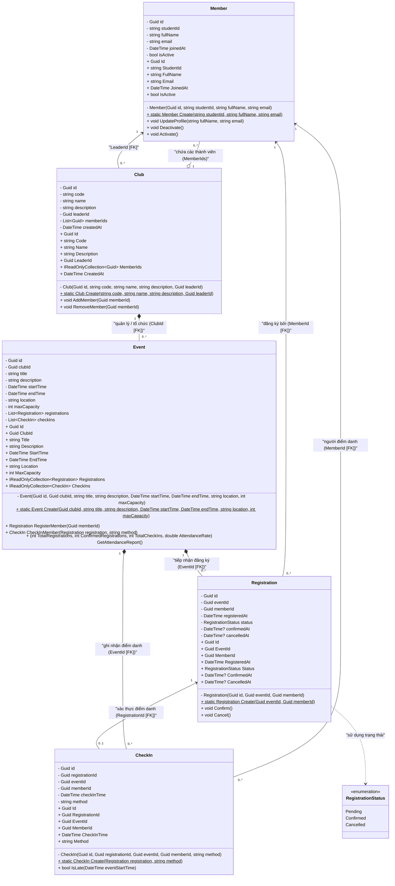

# Sơ Đồ Lớp Miền (Domain Class Diagram) - Hệ Thống EduHub

- **Dự án**: EduHub - Nền tảng quản lý Câu lạc bộ & Sự kiện sinh viên
- **Mã sinh viên**: 0024416184
- **Hoạt động**: HĐ1.3 (CLO1, CLO4, CLO5)
- **Tài liệu**: Sơ đồ lớp Mermaid thể hiện 5 thực thể cốt lõi, thuộc tính, khóa ngoại và quan hệ.

---

## 1. Sơ Đồ Lớp Tổng Quan (Mermaid Class Diagram)

---

## 2. Chi Tiết Thực Thể và Khóa Ngoại (Foreign Keys)

| Thực thể (Class) | Khóa chính (PK) | Khóa ngoại (FK) | Tham chiếu đến (References) | Mô tả quan hệ |
| :--- | :--- | :--- | :--- | :--- |
| **Member** | `Id (Guid)` | Không có | - | Đại diện cho sinh viên trong hệ thống EduHub. |
| **Club** | `Id (Guid)` | `LeaderId (Guid)` | `Member.Id` | Một CLB được dẫn dắt bởi đúng 1 Trưởng CLB (`1 - 1`). CLB chứa danh sách thành viên (`1 - 0..*`). |
| **Event** | `Id (Guid)` | `ClubId (Guid)` | `Club.Id` | Một sự kiện thuộc về duy nhất 1 CLB (`1 - 0..*`). |
| **Registration** | `Id (Guid)` | `EventId (Guid)` `MemberId (Guid)` | `Event.Id` `Member.Id` | Phiếu đăng ký kết nối 1 Member với 1 Event (`1 - 0..*`). Trạng thái được kiểm soát bởi `RegistrationStatus`. |
| **CheckIn** | `Id (Guid)` | `RegistrationId (Guid)` `EventId (Guid)` `MemberId (Guid)` | `Registration.Id` `Event.Id` `Member.Id` | Bản ghi điểm danh kiểm tra và liên kết với phiếu đăng ký hợp lệ (`1 - 0..1`). |

---

## 3. Bội Số Quan Hệ (Multiplicity) và Ý Nghĩa Nghiệp Vụ

1. **Club - Member (Quan hệ Trưởng CLB và Thành viên)**:
   - Một `Member` có thể là Trưởng CLB của `0` hoặc nhiều (`*`) CLB.
   - Một `Club` phải có đúng `1` Trưởng CLB (`LeaderId`).
   - Một `Club` kết tập (`Aggregation: o--`) nhiều `Member` qua danh sách `MemberIds`.

2. **Club - Event (Quan hệ Tổ chức)**:
   - Một `Club` có thể tổ chức từ `0` đến nhiều (`0..*`) `Event`.
   - Mỗi `Event` bắt buộc trực thuộc duy nhất `1` `Club` (`Composition: *--`).

3. **Event - Registration (Quan hệ Đăng ký)**:
   - Một `Event` có thể nhận từ `0` đến `MaxCapacity` phiếu `Registration`.
   - Mỗi `Registration` thuộc về duy nhất `1` `Event`.
   - Mỗi `Member` có thể tạo nhiều `Registration` nhưng không được đăng ký trùng lặp trong cùng một `Event`.

4. **Registration - CheckIn (Quan hệ Điểm danh)**:
   - Mỗi `Registration` hợp lệ (`Confirmed`) chỉ sinh ra tối đa `1` bản ghi `CheckIn` tương ứng (`0..1`).
   - Mỗi bản ghi `CheckIn` bắt buộc phải tham chiếu đến đúng `1` phiếu `Registration` đã xác nhận.

5. **Quy tắc bất biến (Invariants & Encapsulation)**:
   - Toàn bộ thuộc tính có private setter, bảo đảm không bị can thiệp trái phép ngoài Domain boundary.
   - Khởi tạo bắt buộc qua Factory Method static `Create(...)` có validation.
   - Phiếu `Cancelled` không được phép `Confirm`.
   - Chỉ phiếu `Confirmed` mới được phép `CheckIn`.
   - Không cho phép đăng ký khi đã đầy sức chứa (`MaxCapacity`) hoặc đăng ký trùng.
